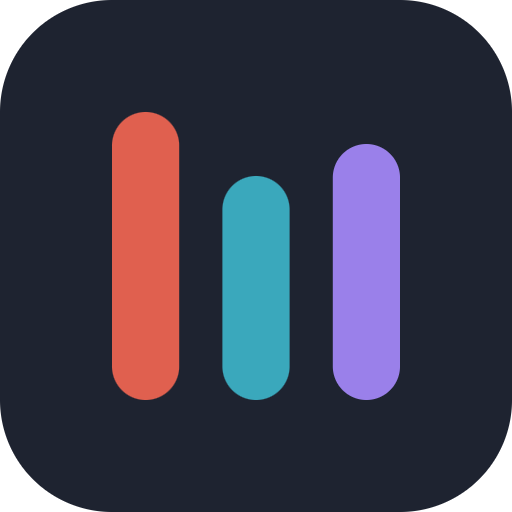
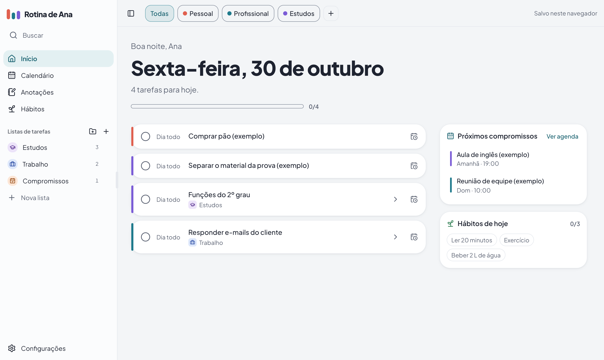
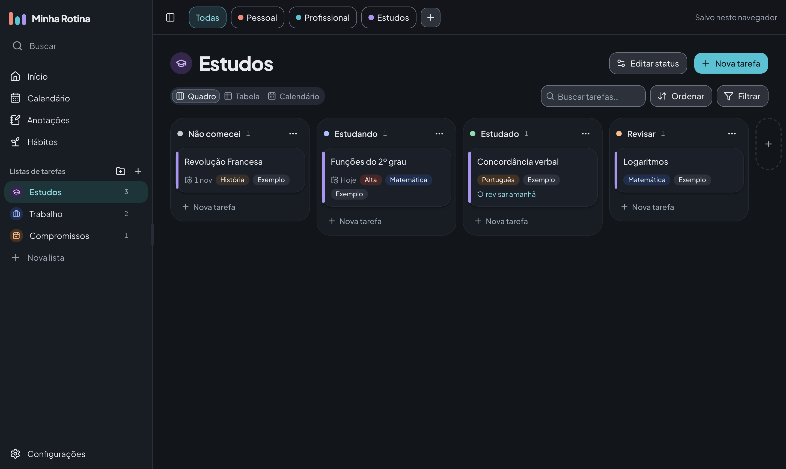
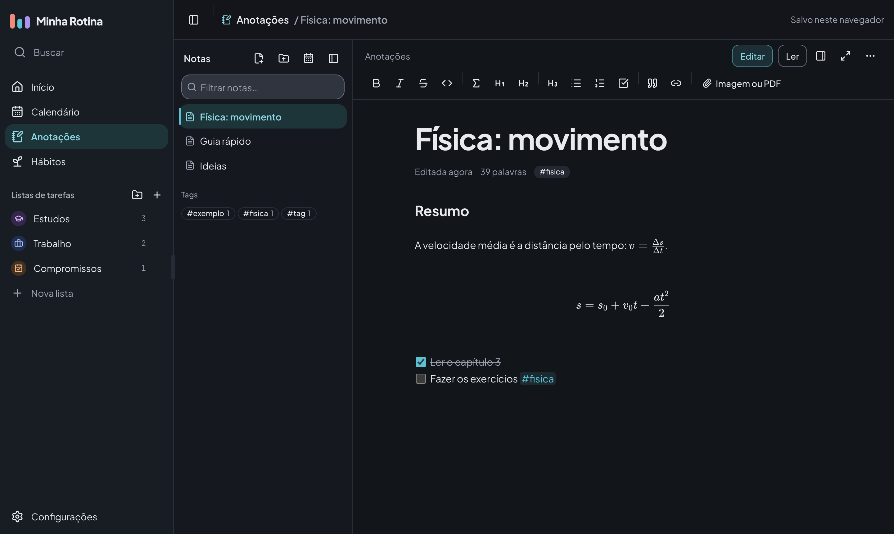
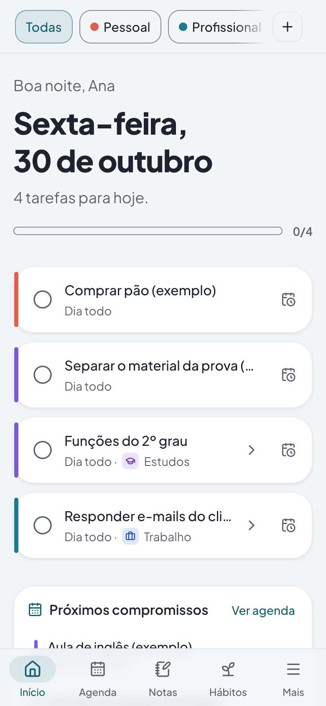
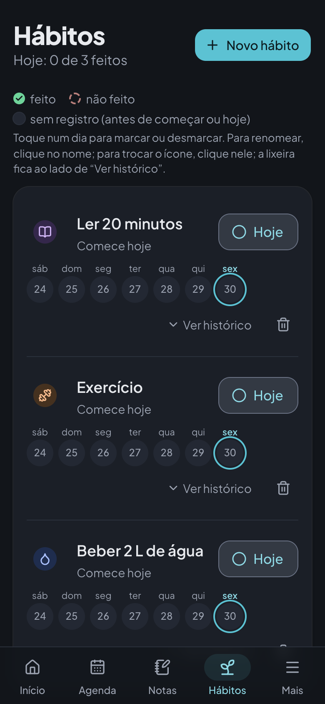

<div align="center">



# Organizer

### Seu dia inteiro, num lugar só.

Tarefas, calendário, hábitos e anotações em um app simples, bonito e feito para o dia a dia,
no computador, no tablet e no celular.

<br />

<a href="https://organizerapp.vercel.app">
  
</a>

<br /><br />


<br />



</div>

<br />

## 💡 A ideia

A rotina costuma ficar espalhada: tarefas num app, compromissos em outro, hábitos num caderno e
ideias em notas soltas. O **Organizer** junta tudo isso em um só lugar, com uma pergunta no centro:

> **O que eu preciso fazer hoje?**

Ao abrir, você vê o seu dia: o que vence hoje, o que ficou para trás, os próximos compromissos e os
hábitos do dia. Concluir ou remarcar leva um toque. O resto (listas, calendário, notas) está a um
clique de distância, sem telas complicadas.

<br />

## ✨ O que dá para fazer

<table>
  <tr>
    <td width="50%" valign="top">
      <h3>✅ Tarefas</h3>
      Listas em quadro, tabela ou calendário, organizadas em pastas. As tarefas se ordenam sozinhas por prazo e prioridade.
    </td>
    <td width="50%" valign="top">
      <h3>📅 Calendário</h3>
      Visões de mês e semana, eventos que se repetem e tarefas com data, tudo junto. Arraste para remarcar.
    </td>
  </tr>
  <tr>
    <td valign="top">
      <h3>🔔 Alarmes</h3>
      Avisos por e-mail ou WhatsApp, na hora ou com antecedência, para eventos e tarefas.
    </td>
    <td valign="top">
      <h3>🌱 Hábitos</h3>
      Marque o dia com um toque e acompanhe a sequência de dias seguidos.
    </td>
  </tr>
  <tr>
    <td valign="top">
      <h3>📝 Anotações</h3>
      Markdown com pré-visualização, fórmulas LaTeX, imagens, PDF, pastas e #tags.
    </td>
    <td valign="top">
      <h3>🎨 Do seu jeito</h3>
      Tema claro ou escuro, cor de destaque, papel de parede e mais de 150 ícones.
    </td>
  </tr>
</table>

<br />

## 🖼️ Por dentro

<table>
  <tr>
    <td width="50%"></td>
    <td width="50%"></td>
  </tr>
  <tr>
    <td align="center"><sub>Quadro de tarefas, no tema escuro</sub></td>
    <td align="center"><sub>Anotações com fórmulas</sub></td>
  </tr>
</table>

<div align="center">
  
  &nbsp;&nbsp;&nbsp;
  
  <br />
  <sub>No celular: o dia e os hábitos</sub>
</div>

<br />

## 🌿 Pensado para o dia a dia

- **Rápido de usar:** concluir, remarcar e criar levam um ou dois toques, e quase tudo tem **Desfazer**.
- **Em qualquer tela:** navegação própria no celular, arrastar e soltar por toque, e instalação como app (PWA).
- **Sempre com você:** com uma conta, os dados sincronizam entre aparelhos e continuam funcionando sem internet.
- **Seguro:** cada pessoa só acessa os próprios dados, com lixeira de 30 dias e backup.
- **Acessível:** contraste conferido (WCAG AA), navegação por teclado e suporte a leitores de tela.

<br />

## 🛠️ Feito com

**React 19**, **TypeScript** e **Vite** · **Tailwind CSS** e **shadcn/ui** · **Supabase** (contas, banco e
alarmes) · **CodeMirror** e **KaTeX** nas anotações · hospedado na **Vercel**.

<br />

## 👩‍💻 Para desenvolvedores

```bash
npm run setup   # instala as dependências do frontend
npm run dev     # http://localhost:5173 (sem configuração, os dados ficam no navegador)
```

O código fica em duas pastas: **`frontend/`** (o site e os apps) e **`backend/`** (banco e funções no Supabase).
Para contribuir, veja o **[CONTRIBUTING.md](CONTRIBUTING.md)**.

Como ligar a nuvem, os alarmes e publicar: **[docs/CONFIGURACAO.md](docs/CONFIGURACAO.md)**. Apps para Android e iPhone: **[docs/APLICATIVO.md](docs/APLICATIVO.md)**.

<br />

<div align="center">
  <sub>Feito com cuidado para deixar a rotina mais leve.</sub>
</div>
